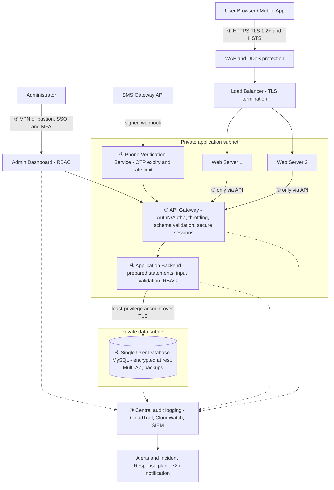

# ConnectSphere – Prioritized Risk Analysis (Set 1)

**Role:** Independent Cybersecurity Governance Consultant
**Scope:** ConnectSphere – Professional Event Networking MVP (user profiles, event registration, secure messaging)
**Data in scope:** PII (name, email, phone, company, title) and event registration data
**Frameworks applied:** CIA Triad, Principle of Least Privilege (PoLP), Defense in Depth, Secure SDLC (SSDLC), OWASP Top 10, GDPR, CCPA/CPRA

---

## Flaws observed in the Set 1 diagram

| # | Observation in the diagram | Principle violated | Reference |
| --- | --- | --- | --- |
| A | Browser / mobile app → Web Server over **HTTP (unencrypted)** | Confidentiality (data in transit) | OWASP A02, CWE-319, GDPR Art. 32 |
| B | **Admin Dashboard Access: Public, No Auth** between the two databases | Confidentiality, PoLP, access control | OWASP A01/A07, CWE-306 |
| C | Application Backend sends **SQL queries without prepared statements** | Integrity, input validation | OWASP A03, CWE-89 |
| D | Public-facing EC2 web servers connect **directly to the databases**, bypassing API Gateway and backend | Defense in Depth, PoLP, segmentation | CWE-653 |
| E | **Two separate "User Database" MySQL instances** with no defined source of truth | Integrity and Availability | GDPR Art. 5(1)(d), Art. 32(1)(b)(c) |
| F | **Phone Verification Service** and SMS Gateway feed the backend and DB directly, with no visible authentication, rate limiting or replay protection | Integrity, Availability (SMS abuse) | OWASP A07, CWE-770 |
| G | No logging, monitoring or incident response component anywhere | Accountability, detection | OWASP A09, GDPR Art. 33 |
| H | No visible session management (tokens, cookies, expiry) | Confidentiality, authentication | OWASP A07 |

---

## Deliverable 1 – Cybersecurity Governance Review Card

| Section | Issue / Definition | Impact | Suggested Fix / Mitigation |
| --- | --- | --- | --- |
| **1. Confidentiality Risk** *(CIA – Confidentiality, PoLP)* | PII travels over **plain HTTP**, and the **admin dashboard is public with no authentication** and has access to the user databases. Anyone on the network path, or anyone on the internet, can read or export names, emails, phone numbers and registrations. | Mass PII disclosure and account takeover. GDPR Art. 32 and Art. 33 breach (72h notification), CCPA statutory damages, loss of investor trust. **Severity: Critical.** | Enforce **HTTPS (TLS 1.2+)** with HSTS and redirect all HTTP traffic. Terminate TLS on the load balancer with an ACM certificate and re-encrypt to the backend. Remove public exposure of the admin dashboard: reach it only through VPN / bastion + SSO with **MFA**, and apply **RBAC** (PoLP). Encrypt databases at rest (KMS). |
| **2. Integrity Risk** *(CIA – Integrity, Input Validation, SSDLC)* | The backend builds **SQL queries without prepared statements** and there is no input validation. In addition, web servers write straight to the databases and two different User DBs exist, so there is no single authoritative record. | SQL injection lets an attacker alter, delete or exfiltrate data. Divergent copies of user records cause corrupted profiles and registrations. **Severity: High.** | Use **parameterized queries / ORM**, server-side allow-list validation and output encoding. Add schema validation at the API Gateway. Give the backend a **least-privilege DB account** (no DROP / GRANT). Consolidate to **one authoritative User DB**. Add SAST/DAST and code review gates in the CI/CD pipeline (SSDLC). |
| **3. Availability Risk** *(CIA – Availability, Defense in Depth)* | Public EC2 web servers have direct DB connections and there is **no rate limiting or WAF**. The phone-verification / SMS flow can be hammered (SMS pumping). Duplicate DBs have no stated HA, backup or failover design. | DDoS, injection-driven DB overload or a single DB failure makes registration and messaging unavailable. SMS abuse also creates uncontrolled costs. **Severity: Medium-High.** | Place **AWS WAF + Shield** and API Gateway **throttling** in front. Move web servers to private subnets and let only the backend reach the DB. Run the DB **Multi-AZ with automated backups and tested restores** (defined RTO / RPO). Add per-number and per-IP OTP limits with expiry and CAPTCHA. |
| **4. Monitoring / Reporting Recommendation** | **Metric:** *Unauthorized Access Attempts per Hour*, the count of HTTP 401/403 responses and failed authentications on admin and API endpoints, broken down by endpoint and by (pseudonymized) source. | **Visualization:** **Heatmap** (hour of day × endpoint), with an alert threshold overlay. | **Why it matters:** it reveals brute-force, scanning and privilege-escalation attempts early, so the team can contain an incident inside the 72-hour GDPR notification window. |

---

## Deliverable 2 – Corrected Architecture Diagram

### Annotated original (flaw → correction)

| Marker | Location on the original diagram | Correction made | Why |
| --- | --- | --- | --- |
| **①** | Browser → Web Server, "HTTP (Unencrypted)" | Replace with **HTTPS / TLS 1.2+**, HSTS, HTTP→HTTPS redirect, TLS to the backend | Protects PII and ensures data-in-transit confidentiality. |
| **②** | Both Web Servers → User DB (direct lines, red ✖) | **Remove direct DB access.** Web servers move to a private subnet and call only the API Gateway | Defense in Depth and PoLP: the public tier must never touch the data tier. |
| **③** | API Gateway | Add **authentication (OAuth2 / JWT), authorization, throttling and request-schema validation**. Sessions use `Secure; HttpOnly; SameSite` cookies or short-lived tokens with rotation | Closes weak API access control and adds secure session management. |
| **④** | Application Backend, "SQL Queries (No prepared statements)" | **Prepared statements / ORM** + server-side validation + least-privilege DB account | Stops SQL injection and protects data integrity. |
| **⑤** | "Admin Dashboard Access (Public, No Auth)" | Remove the public path. Access only via **VPN / bastion + SSO + MFA + RBAC**, with every admin action logged | PoLP and prevention of privilege escalation. |
| **⑥** | Two "User Database MYSQL DB" | **Merge into one authoritative DB**: encrypted at rest, Multi-AZ, backups, private subnet | Eliminates data divergence and improves availability and integrity. |
| **⑦** | Phone Verification Service / SMS Gateway | Verification goes **through the API Gateway only** (signed webhooks, OTP expiry, retry and rate limits) and never writes to the DB directly | Prevents forged verification and SMS abuse. |
| **⑧** | *(missing)* | Add **centralized audit logging (CloudTrail / CloudWatch → SIEM)**, alerts and a documented **Incident Response plan** | Detection, accountability and breach notification (GDPR Art. 33). |

### Corrected architecture

---

## Deliverable 3 – Summary of Review Process

I began by reading the project brief and tracing every data flow in the Set 1 diagram, tagging each red marker with the principle it breaks. Under the **CIA Triad**, unencrypted HTTP and the public admin dashboard threatened confidentiality, missing prepared statements and duplicate databases threatened integrity, and direct web-to-database links with no rate limiting threatened availability. I applied the **Principle of Least Privilege** by removing the public admin path, forcing MFA and RBAC, and giving each component only the database rights it needs. **Secure SDLC** practice appears as parameterized queries, input validation, and SAST/DAST checks in the pipeline, so these flaws are caught before release.

These findings directly improve compliance. TLS, encryption at rest and access control satisfy GDPR Art. 32 (security of processing) and support Art. 25 (data protection by design). Centralized logging and an incident response plan make the 72-hour notification duty of Art. 33 achievable. A single authoritative user database supports data accuracy under Art. 5(1)(d) and makes access and deletion requests under GDPR and CCPA easier to honour. For the investors' due diligence, each fix maps to a recognized control, which makes the remediation auditable.

The recommended metric, *Unauthorized Access Attempts per Hour*, supports ethical and transparent governance because it measures protection of users rather than surveillance of them. It can be reported in aggregate, with pseudonymized sources, to leadership and investors. It gives an honest, evidence-based view of risk, and it shows the organization is accountable for protecting the personal data it holds.
