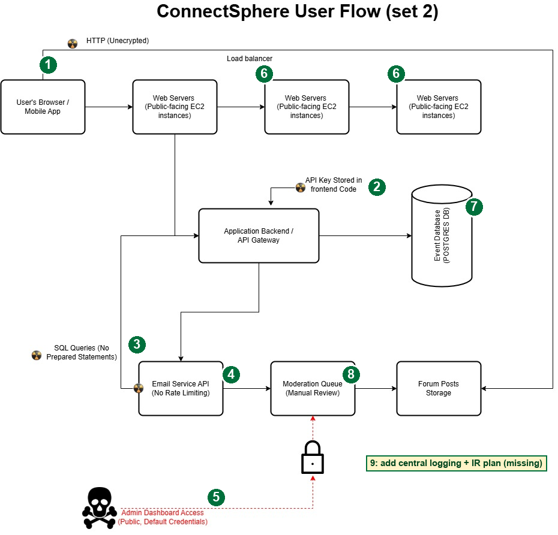
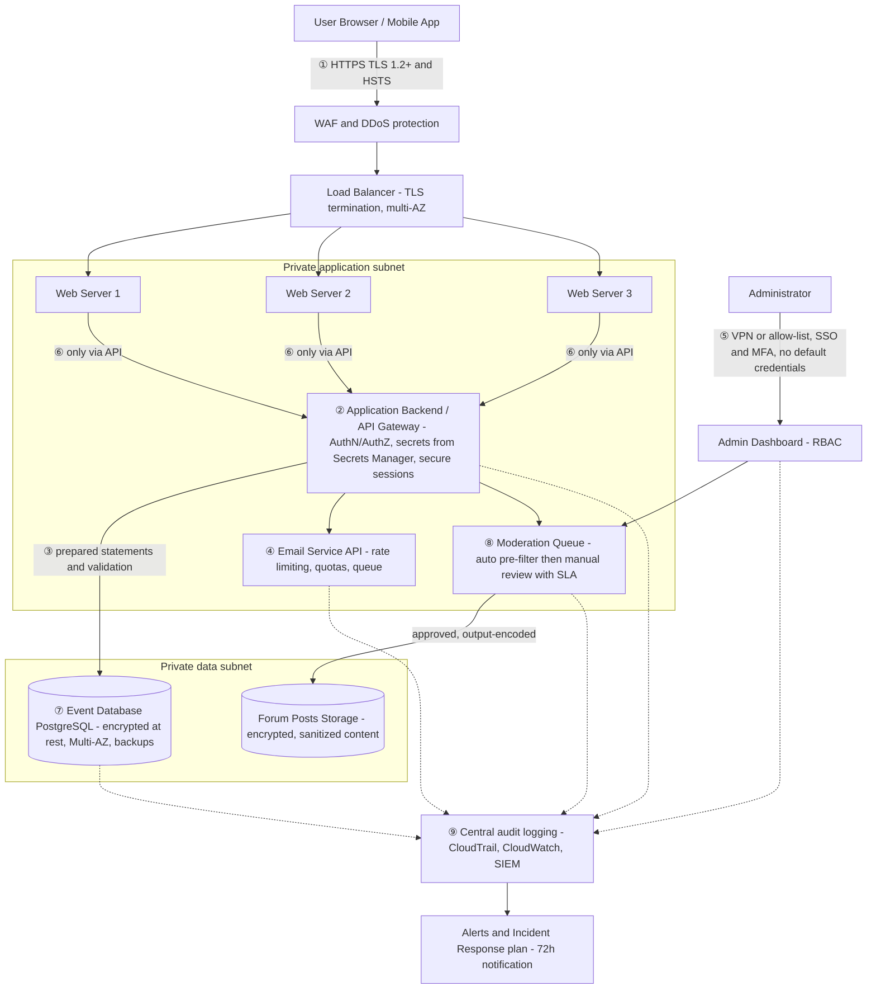

# ConnectSphere – Prioritized Risk Analysis (Set 2)

**Role:** Independent Cybersecurity Governance Consultant
**Scope:** ConnectSphere – Professional Connection Platform V1 (profiles, virtual workshop RSVP, moderated forums, planned "contact request" feature)
**Data in scope:** Profile data (name, employer, title, skills, LinkedIn URL), event attendance records, forum post content
**Frameworks applied:** CIA Triad, Principle of Least Privilege (PoLP), Defense in Depth, Secure SDLC (SSDLC), OWASP Top 10, GDPR, CCPA/CPRA

---

## Flaws observed in the Set 2 diagram

| # | Observation in the diagram | Principle violated | Reference |
| --- | --- | --- | --- |
| A | Browser → Web Servers / Forum Posts Storage over **HTTP (unencrypted)** | Confidentiality (data in transit) | OWASP A02, CWE-319, GDPR Art. 32 |
| B | **API key stored in frontend code** feeding the Application Backend | Confidentiality, secrets management | OWASP A05/A07, CWE-798 |
| C | **SQL queries without prepared statements** | Integrity, input validation | OWASP A03, CWE-89 |
| D | **Email Service API has no rate limiting** | Availability, abuse prevention | OWASP API4, CWE-770 |
| E | **Admin Dashboard Access: Public, Default Credentials**, reaching the Moderation Queue | Confidentiality, Integrity, PoLP | OWASP A07, CWE-1392 |
| F | Web servers are drawn in a **chain** (server → server → server) instead of in parallel behind the load balancer, and one web server reaches Forum Posts Storage and the backend directly | Availability (single points of failure), Defense in Depth | CWE-653 |
| G | Forum content is stored and published with no stated sanitization, and the **manual-only moderation queue** is a bottleneck | Integrity (stored XSS), Availability | OWASP A03 |
| H | One PostgreSQL event DB with no stated replication, backup or encryption | Availability, Confidentiality | GDPR Art. 32(1)(b)(c) |
| I | No logging, monitoring or incident response; no session management | Accountability, detection | OWASP A09, GDPR Art. 33 |

---

## Deliverable 1 – Cybersecurity Governance Review Card

| Section | Issue / Definition | Impact | Suggested Fix / Mitigation |
| --- | --- | --- | --- |
| **1. Confidentiality Risk** *(CIA – Confidentiality, PoLP)* | Profile data and sessions travel over **plain HTTP**, an **API key is hard-coded in frontend code** (readable by any visitor), and the **admin dashboard is public with default credentials**. | Interception of profile data, theft of the API key to call backend and email services as ConnectSphere, and full admin takeover of moderation. GDPR Art. 32 / 33 breach and CCPA exposure. **Severity: Critical.** | Enforce **HTTPS / TLS 1.2+** with HSTS. Move all secrets to the backend in a **secrets manager** (AWS Secrets Manager), **rotate the exposed key now**, and give the frontend only short-lived user tokens. Remove the public admin path: VPN / allow-list + SSO + **MFA**, no default credentials, **RBAC** (PoLP). |
| **2. Integrity Risk** *(CIA – Integrity, Input Validation, SSDLC)* | **SQL built without prepared statements** and no validation or output encoding of forum content. The compromised or unauthenticated admin path can also approve, edit or delete moderated posts. | SQL injection corrupts or leaks event and attendance records. Stored XSS in forum posts hijacks other users' sessions. The USP of a "curated and secure environment" is destroyed. **Severity: High.** | **Parameterized queries / ORM**, allow-list validation, **output encoding and a Content-Security-Policy** for forum content. Least-privilege DB accounts. Make moderation actions **audit-logged and immutable**. SAST/DAST and peer review in the CI/CD pipeline (SSDLC). |
| **3. Availability Risk** *(CIA – Availability, Defense in Depth)* | The **Email Service API has no rate limiting** (spam, email-bombing, cost abuse, and a likely vector for the planned "contact request" feature). Web servers are chained, which creates single points of failure, and the single event DB has no stated HA or backup. | Email provider blocks or suspends the sender, events become unreachable during a flood, and the business goal of "consistent availability for events" is missed. **Severity: High.** | **Rate limiting and quotas** per user / IP, CAPTCHA, queue-based sending, SPF / DKIM / DMARC. Put web servers **in parallel behind the load balancer** across AZs with auto-scaling and WAF / Shield. Run PostgreSQL **Multi-AZ with automated backups and tested restores** (defined RTO / RPO). |
| **4. Monitoring / Reporting Recommendation** | **Metric:** *Email API Request Rate vs. Threshold*, requests per minute per account and per IP to the Email Service API, plus the count of throttled (HTTP 429) requests. | **Visualization:** **Line chart** (time series with a threshold line and a 429 overlay). | **Why it matters:** it exposes spam, abuse and credential-stuffing patterns before they exhaust the email service and take events offline. |

---

## Deliverable 2 – Corrected Architecture Diagram

### Annotated original (flaw → correction)

| Marker | Location on the original diagram | Correction made | Why |
| --- | --- | --- | --- |
| **①** | "HTTP (Unencrypted)" path from the User's Browser | **HTTPS / TLS 1.2+** end to end, HSTS, HTTP→HTTPS redirect | Protects profile data and ensures data-in-transit confidentiality. |
| **②** | "API Key Stored in frontend Code" | Move the key to the **backend and a secrets manager**, rotate it, and use short-lived tokens with `Secure; HttpOnly; SameSite` cookies for sessions | Removes a hard-coded secret and adds secure session management. |
| **③** | "SQL Queries (No Prepared Statements)" | **Prepared statements / ORM**, server-side validation, output encoding for forum content | Stops SQL injection and stored XSS, and protects integrity. |
| **④** | "Email Service API (No Rate Limiting)" | **Rate limiting, quotas, CAPTCHA, queue**, SPF / DKIM / DMARC | Prevents spam and abuse and keeps the service available. |
| **⑤** | "Admin Dashboard Access (Public, Default Credentials)" | Remove the public path. **VPN / allow-list + SSO + MFA + RBAC**, no default credentials, forced rotation | PoLP and prevention of unauthorized moderation. |
| **⑥** | Chained Web Servers, and direct paths to the backend and Forum Posts Storage | Web servers sit **in parallel behind the load balancer** and talk **only to the API Gateway**. Storage and DB live in private subnets | Removes single points of failure and enforces Defense in Depth. |
| **⑦** | Event DB and Forum Posts Storage | **Multi-AZ PostgreSQL**, encryption at rest (KMS), backups, restore tests | Availability and confidentiality of stored data. |
| **⑧** | Moderation Queue (Manual Review) | **Automated pre-filter + manual queue with an SLA**, least-privilege moderator role | Keeps the "spam-free" USP without creating a bottleneck. |
| **⑨** | *(missing)* | **Central audit logging (CloudTrail / CloudWatch → SIEM)**, alerts and an **Incident Response plan** | Detection, accountability and breach notification (GDPR Art. 33). |

### Corrected architecture

---

## Deliverable 3 – Summary of Review Process

I reviewed the Set 2 brief first, noting that its promise of a "curated and secure environment" with consistent availability sets the bar, then traced each flow in the diagram and linked every red marker to a principle. Under the **CIA Triad**, HTTP, a hard-coded API key and a public admin panel with default credentials threaten confidentiality. Missing prepared statements and unsanitized forum content threaten integrity. An unthrottled email API and chained web servers threaten availability. I applied the **Principle of Least Privilege** through MFA, RBAC, a restricted moderator role and least-privilege database accounts, and **Secure SDLC** through parameterized queries, secrets management and automated security testing before release.

These fixes strengthen compliance. TLS, encryption at rest and access control align with GDPR Art. 32, while privacy by design for the planned contact-request feature aligns with Art. 25. Audit logging and an incident response plan make Art. 33 breach notification realistic, and CCPA's "reasonable security" expectation is met by documented controls. This gives the investors' auditors verifiable evidence instead of promises.

The recommended metric, *Email API Request Rate vs. Threshold*, supports ethical and transparent governance because it monitors system behaviour and abuse, not the content of people's messages. It can be shared in aggregate with leadership and investors, it protects users from spam and harassment, and it shows measurable accountability for the platform's availability and trustworthiness.
